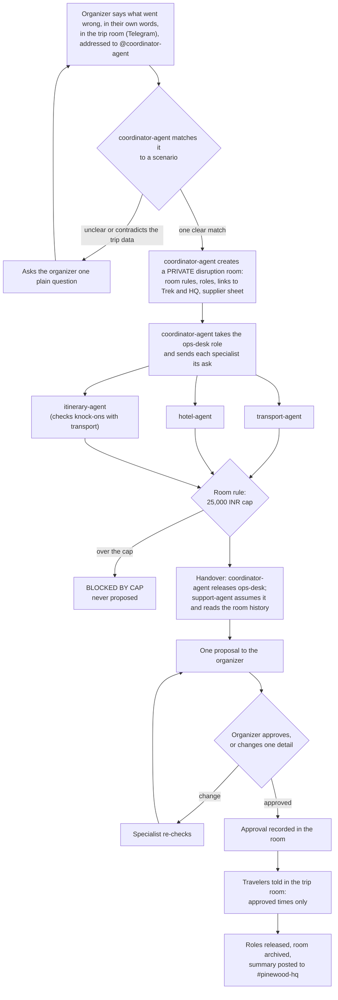

# TripRescue

> Every disruption has another route.

A team of AI agents and one person rescues a group trip when something breaks. Built on [Switch](https://docs.switchagents.ai/) for the Flip the Switch Hackathon (Track 01, Best Business Workflow).

**Demo video:** _link added at submission_

## The problem

A small tour operator runs a group trip as a chain of bookings: coach, camp, guide, meals, the next day's departure. At 06:52 on Day 3 the coach supplier cancels. Twenty travelers are waiting, and the organizer has a few hours to:

- find replacement transport,
- keep the hotel, guide and tomorrow's departure in step,
- stay inside the contingency budget,
- and tell the travelers one clear plan.

Today that happens by phone and in scattered chat threads. Answers arrive separately. A change in one place, such as moving the trek, silently breaks another, such as tomorrow's departure. The budget is checked last, if at all.

TripRescue changes three things:
- Specialists work in parallel from one shared record.
- Knock-on effects are checked before the organizer sees anything.
- A room rule blocks any option over the cap.

The organizer approves **one** proposal, and the travelers get **one** message. No agent books or pays.

Pinewood Holidays, the Parvati Valley Trek, its travelers and its suppliers are all fictional (see [Sample data](#sample-data)).

## How it works



The organizer types four messages per disruption: what went wrong (in their own words), one change, the final approval, and "close the room". Everything else is agents talking to each other through Switch.

In the demo, travelers are in a Telegram group, while Pinewood HQ and the private disruption rooms are on Mattermost. Switch links rooms across the two apps.

## How Switch is used

| Switch feature | What it does in TripRescue |
| --- | --- |
| **Rooms** | Pinewood HQ (operator base), Parvati Trek (travelers), and one disruption room per incident, created by an agent with `create_room` and private, so travelers never see options under discussion. |
| **Room instructions** | The four business rules (cost cap, keep the group together, agents propose / organizer approves, label every option) are written once in [`rooms/parvati-disruption.md`](rooms/parvati-disruption.md) and read by every agent in the room. No rule is in code. |
| **Roles** | `ops-desk`, `transport`, `hotel`, `itinerary` ([`rooms/roles/`](rooms/roles/)). The ops desk is a job, not an agent: coordinator-agent holds it while answers come in, then releases it, and support-agent assumes it and continues from the room history. |
| **Linked rooms** | Each disruption room links to Parvati Trek (`parent trip`) and Pinewood HQ (`escalation`), so agents know where to tell travelers and where to report. |
| **References** | The supplier sheet is attached to the disruption room as a reference. |
| **Targeted messages** | Agents ask each other with `send_targeted_message` (by name, or by role such as `@ops-desk`). Only addressed messages wake an agent, so each one works when asked and stays quiet otherwise. |
| **Human approval** | The organizer approves in the room. A split of the group needs its own explicit approval. The approval is recorded as a line in the room. |
| **Archive** | `archive_room` closes the disruption and keeps its history. The close-out summary goes to HQ, and a short note goes to the trip room. |
| **Chat apps** | Mattermost, bundled with the local Switch server, hosts Pinewood HQ and the private disruption rooms. Commands use `!`, e.g. `!list-agents`. In the demo, travelers are on Telegram. One Switch bot serves every agent there, and the disruption room links to the Telegram room like any other. Room rules do not depend on the chat app. |

**The remove-Switch test:** without Switch you have five separate chatbots with no shared room history, no rules they all read, no role that can pass between them, and no approval step. The workflow cannot run.

## Agents

All five are existing Claude Code agents run by Switch Console. Each one's brief is a `CLAUDE.md` in its own folder, and its permissions are in `.claude/settings.json`.

| Agent | Model | Job | Cannot |
| --- | --- | --- | --- |
| [`coordinator-agent`](agents/coordinator-agent/CLAUDE.md) | claude-sonnet-5-5 | Matches the organizer's words to a scenario (or asks one plain question), opens the disruption room from the scenario file, holds ops-desk while specialists answer, hands over, closes and archives | Edit files, run commands |
| [`support-agent`](agents/support-agent/CLAUDE.md) | claude-sonnet-5-5 | Answers travelers from the trip plan, takes over ops-desk, writes the single proposal, tells travelers the approved plan | Create, link or archive rooms, invite agents |
| [`transport-agent`](agents/transport-agent/CLAUDE.md) | claude-haiku-5-5 | Replacement transport from the supplier sheet, labelled CONFIRMED or ADVERTISED ONLY | Create, link or archive rooms |
| [`hotel-agent`](agents/hotel-agent/CLAUDE.md) | claude-haiku-5-5 | Late check-in, meal and room changes | Create, link or archive rooms |
| [`itinerary-agent`](agents/itinerary-agent/CLAUDE.md) | claude-sonnet-5-5 | Rebuilds the day and checks knock-ons, such as the next day's departure | Create, link or archive rooms |

No agent can read `.env` or write files. [`tests/test_agents.py`](tests/test_agents.py) checks these permissions.

## Set up

Tested on **Windows 11** with Switch Console 0.40.1 (switch-core 0.31.0). Console is documented for macOS; its Windows build is early access, and we have not tested macOS or Linux.

### 1. Install

- [Docker Desktop](https://www.docker.com/products/docker-desktop/), running.
- [Switch Console](https://github.com/sandbox-quantum/switch/releases/latest).
- [Claude Code](https://docs.claude.com/en/docs/claude-code), signed in: `claude auth login`.
- Python 3.10 or newer, and git.

### 2. Clone and check

```bash
git clone https://github.com/RagulSid/triprescue.git
cd triprescue
python scripts/setup.py
```

`setup.py` checks Python, the seed data, the agent folders, Docker, the bundled Mattermost container, the Claude Code sign-in, that `.env` is not tracked, and the tests. It exits 0 only if all pass.

The Mattermost check passes after step 3. The demo needs no `.env` or tokens.

### 3. Start the local Switch server

In Switch Console, start the local server. The first start downloads a few GB. It brings up the bundled Mattermost. Sign in to Mattermost from Console (the exact screen is **Unverified** for a fresh install).

### 4. Register the five agents (manual, about 5 minutes)

Run `python scripts/setup.py --agents`. It prints every field below with this clone's real paths.

In Switch Console: **Your Agents** → the **+** card. Fill in the form once per agent, then **Add agent**.

| Field | Value |
| --- | --- |
| Name | `coordinator-agent`, `support-agent`, `transport-agent`, `hotel-agent`, `itinerary-agent` |
| Description | One line from [`agents/agents.json`](agents/agents.json) |
| Agent instructions | From `agents/agents.json`. Each is a short pointer like "Follow CLAUDE.md in your directory." The real brief is the folder's `CLAUDE.md`. |
| Run location | This computer |
| Directory | `<clone>/agents/<name>` |
| Agent provider | Claude Code. Leave the model alone: it comes from `.claude/settings.json`. |

Then open **support-agent** → **Who can talk to your agent** and allow travelers (anyone) to address it. Leave the other four on the default, which is you and your agents. That is all the specialists need.

### 5. Create the two base rooms (manual, about 2 minutes)

In Switch Console: **Your Rooms** → **Create room**, messaging app **Mattermost**.

| Name | Agents | Instructions (paste the whole file) |
| --- | --- | --- |
| `Pinewood HQ` | coordinator-agent | [`rooms/pinewood-hq.md`](rooms/pinewood-hq.md) |
| `Parvati Trek` | support-agent, coordinator-agent | [`rooms/parvati-trek.md`](rooms/parvati-trek.md) |

The names must match exactly: coordinator-agent finds these rooms by the names in [`rooms/rooms.json`](rooms/rooms.json). Disruption rooms are created by the agent, not by you.

**Travelers on Telegram (optional; our demo uses it):**
1. In BotFather, turn Group Privacy off before the bot joins any chat.
2. Connect Telegram in Console, and leave Mattermost as the default for new rooms.
3. Add the bot to your Telegram group and invite `support-agent` and `coordinator-agent` there.
4. Create `rooms/rooms.local.json` (gitignored) with `{"trip_room": "<the group's room name exactly as Console shows it>"}`. Console names it `<connection name>: <group title>`, and renaming the group later does not change it.

Disruption rooms stay private on Mattermost and link to the Telegram room. Nothing is renamed or archived.

Optional: create a second Mattermost account as a traveler and add it to `#parvati-trek` only. This shows that travelers never see the private disruption room.

Check: type `!list-agents` in `#parvati-trek` and it lists the agents.

### Shortcut for steps 4 and 5: a Switch template (Unverified)

`python scripts/setup.py --template > ../triprescue-template.yaml` writes a version 2 [Switch template](https://docs.switchagents.ai/switch-rooms/administer/room-templates). It creates the five agents and both rooms with this clone's paths.

In Switch Console, use **Templates** → **Import template**, then **Use**.

Switch's own template planner accepts it offline. We have **not** run it in Console, so follow steps 4 and 5 if it fails. Do not run it where the agents or rooms already exist: two rooms named `Parvati Trek` would stop the coordinator.

## Run a scenario

Each scenario has a guide with the four messages to copy, in order, what to wait for, the expected outcome and what to check by eye. `python scripts/run_scenario.py <name>` prints the same guide.

| Scenario | What breaks | Guide |
| --- | --- | --- |
| `coach_cancelled` | The 08:30 coach is withdrawn; check-in and the trek break | [guide](seed/scenarios/coach_cancelled/README.md) |
| `heavy_rain` | Rain closes the afternoon trek trail | [guide](seed/scenarios/heavy_rain/README.md) |
| `traveler_sick` | One traveler is unwell and leaves; the group splits only with explicit approval | [guide](seed/scenarios/traveler_sick/README.md) |

In short:
1. In the trip room, tell `@coordinator-agent` what went wrong, in your own words. Each guide has example wordings. If the message is vague or contradicts the trip data, the coordinator asks one plain question first. A line `Scenario: <name>` forces a scenario.
2. Wait for the proposal in the new private room.
3. Approve with one change.
4. Give final approval.
5. Ask the coordinator to close the room.

Run one scenario at a time. On our machine a full run took about 5 to 10 minutes, including the organizer's pauses, and 4 to 5 agent sessions.

## Sample data

Everything in [`seed/`](seed/) is synthetic: the operator, trip, travelers, suppliers, prices and the sample clinic in `traveler_sick`. Emails use the reserved `example.com` domain.

- [`seed/supplier_sheet.json`](seed/supplier_sheet.json) holds options marked CONFIRMED.
- Options marked ADVERTISED ONLY stand in for web search results; each scenario includes one, and the cap blocks it.
- `traveler_sick` covers logistics only, with no medical details or advice.

## What is mocked

- Supplier availability and prices come from the seeded sheet, not live systems.
- Nothing is booked or paid. A booking request is a draft for the organizer.
- This shows better coordination. It does not claim to run a real operator's business.

## Known limits

- **The handover is explicit.** Switch never reassigns a role by itself, and a role lease survives an agent going offline. coordinator-agent calls `release_role` and support-agent calls `assume_role`, both by instruction. Each agent holds one role at a time across all rooms, so run one scenario at a time.
- **Address agents with an @mention.** Only addressed messages wake an agent. In our tests a Mattermost post without an @mention sometimes did not reach the agents at all; the cause is **Unverified**. Every message in the guides starts with `@coordinator-agent` or `@ops-desk`.
- **In Telegram, use the `@name` form.** A message that starts with the bare agent name (`coordinator-agent …`) is not routed to the agent. Write `@coordinator-agent …`.
- **Telegram shows Switch's status lines.** Everyone in the group sees Switch's status lines ("Starting a session…", "Working…") and its `/` command menu. We found no setting to hide them from travelers. The agents' own messages to travelers contain no ids or technical detail.
- **The Mattermost channel may stay open after archiving.** `archive_room` archives the room in Switch. In our last three runs the Mattermost channel was also archived, about 25 seconds later. In earlier runs it stayed open until a Mattermost admin archived it. We have not found the cause. If the channel stays open, an admin can archive it (or run `run_scenario.py --archive-channel`).
- **Windows notes.**
  - If agents answer in Console but never in Mattermost, see [WINDOWS.md](WINDOWS.md); WSL mirrored networking breaks the websocket.
  - Agents need Switch Console open and the laptop awake.
- **Developer tooling is optional and Windows-only.**
  - `run_scenario.py --check / --verify / --export / --archive-channel` and `measure_latency.py` read the local Switch database read-only, with the credentials in Switch Console's `switch-core.env`. They assume Console's Windows layout (`%APPDATA%\switchdash`) and the Python bundled with the server.
  - The demo, `setup.py` and the tests never use them.

## Project layout

```text
agents/<name>/CLAUDE.md          each agent's brief
agents/<name>/.claude/settings.json   model and permissions
agents/agents.json               Console registration fields
rooms/*.md                       room instructions (the rules)
rooms/roles/*.md                 role descriptions
seed/                            synthetic trip, travelers, supplier sheet
seed/scenarios/<name>/           scenario data and copy-paste guide
scripts/setup.py                 machine check, Console fields, template
scripts/run_scenario.py          scenario guides (+ optional DB checks)
tests/                           seed, scenario and agent-permission tests
```

```bash
python -m unittest discover tests
```

## Third-party components

- [Switch](https://github.com/sandbox-quantum/switch) and Switch Console run the rooms and agents. They are installed separately, not vendored.
- Claude Code powers the agents.
- The scripts and tests use only the Python standard library.

## Licence

[MIT](LICENSE)
